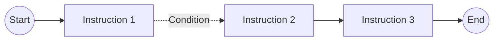

# Process Tab

The **Process** tab is used to define the process diagram (algorithm).

The diagram consists of points connected by one-way transitions. Each transition can contain a condition that determines whether the next step is executed. If no condition is defined, the transition is unconditional.

An algorithm path consists of the steps executed from a start point to an end point. An algorithm can contain multiple paths.

Available diagram elements:

- **Start Points**,
- **Instructions**,
- **End Point**.

Each algorithm should contain at least:

- one start point,
- one instruction,
- one end point.



## Start Points

A start point defines the event that starts the algorithm.

Available types:

- **Click** - starts the algorithm after a trigger is activated. If the algorithm is assigned to a class, it responds to triggers of that class.
- **Before** - starts the algorithm after a value changes, before validation.
- **After** - starts the algorithm after a value changes and passes validation.

## Instructions

An instruction represents a single operation executed by the algorithm.

Each instruction contains common properties:

- `Name` - Instruction code.

:::warning
The name must be unique across the entire database. National and special characters must not be used. Allowed characters are `A-Z`, `_`, and `-`.
:::

- `Description` - Instruction description displayed in the administration application.
- `Variable` - Input or output variable used by the instruction.

Additional properties are available depending on the instruction type.

Available instruction types:

- **Document Line Operations**,
- **Script Operations**,
- **Message Dialog**,
- **Execute DLL**.

Instructions can read data from variables or store operation results in variables.

### Document Line Operations

The **Document Line Operations** instruction performs operations on the document header or document lines.

Additional property:

- `Command type` - Specifies the operation performed on the document.

Available command types:

#### Add Line

Adds a new document line based on data passed in a variable.

Column names in the variable should match the names of document line attributes.

#### Clear Lines

Removes all document lines.

The instruction does not require line data to be passed in a variable.

#### Delete Line

Deletes the specified document line.

The line number is passed in the system column:

- `SYS_LINEID` - ID of the line to be deleted.

#### Get Lines

Retrieves the current document lines into a table variable.

Variable columns correspond to line attributes. The following system field is also returned:

| Field | Description |
| --- | --- |
| `SYS_LINEID` | Document line ID. |

#### Update Lines

Updates attribute values of existing document lines.

The input variable should contain:

- `SYS_LINEID` - ID of the line to be updated,
- columns corresponding to the attributes to be changed.

It is not necessary to provide all line attributes.

#### Get Header

Retrieves document header data into a table variable containing one row.

In addition to header attributes, the following system fields are returned:

| Field | Description |
| --- | --- |
| `SYS_ID` | Document ID. |
| `SYS_USERID` | User ID. |
| `SYS_CLASSID` | Class ID. |
| `SYS_COMPANYID` | Company ID. |
| `SYS_TEMPLATEID` | Template ID. |
| `SYS_NAME` | Document name. |
| `SYS_DESCRIPTION` | Document description. |
| `SYS_DOCDATE` | Document date. |
| `SYS_ENTERDATE` | Document receipt date. |
| `SYS_DOCNUM` | Document number. |

#### Update Header

Updates attributes and selected system fields of the document header.

It is not necessary to provide all fields. The variable can contain only the values that should be updated.

Supported system fields:

| Field | Description |
| --- | --- |
| `SYS_NAME` | Document name. |
| `SYS_DESCRIPTION` | Document description. |
| `SYS_DOCDATE` | Document date. |
| `SYS_ENTERDATE` | Document receipt date. |
| `SYS_DOCNUM` | Document number. |

#### Save Document

Saves changes made to the document by previous algorithm instructions.

#### Add Reference

Adds a new reference to the document.

The input variable must contain the following fields:

- `SYS_ID` - SPUMA document identifier,
- `SYS_OBJECTTYPE` - SAP document type (`ObjType`),
- `SYS_OBJECTID` - SAP internal document number (`DocEntry`).

#### Clear References

Removes all references assigned to the document.

#### Delete Reference

Deletes the specified document reference.

The reference to be deleted should be identified based on data passed in the variable, for example by the reference identifier `SYS_INT_ID`.

#### Get References

Retrieves reference data for the document linked to the document in SAP. The result is stored in a table variable.

Returned system columns:

| Column | Description |
| --- | --- |
| `SYS_INT_ID` | Internal reference identifier. |
| `SYS_COMPANYID` | Company identifier. |
| `SYS_OBJECTTYPE` | SAP document type (`ObjType`). |
| `SYS_OBJECTID` | SAP internal document number (`DocEntry`). |
| `SYS_BOBJECTTYPE` | SAP base document type (`ObjType`) referenced by the document. |
| `SYS_BOBJECTID` | SAP internal base document number (`DocEntry`). |
| `SYS_ISISYS` | Indicates whether the reference was created by the system. Value `1` means that the reference was created automatically, for example by the **Post to SAP** mechanism or based on a base document. |

#### Update Reference

Updates the specified document reference.

The input variable must contain the following field:

- `SYS_INT_ID` - Internal identifier of the reference to be updated.

Other columns passed in the variable specify the values to be updated.

### Script Operations

The **Script Operations** instruction executes an SQL query and stores its result in a table variable.

Properties:

- `Script type` - Database connection type.
- `Script` - SQL query.

When creating a query, remember that variables from the entire process are available. They are stored in temporary tables:

```text
#VARIABLE_NAME
```

For example, the `HDR` variable is available as:

```sql
#HDR
```

### Message

The **Message** instruction displays a window with information or a selection to the user.

The selected value can be stored in a variable of type `Int`.

Properties:

- `Message` - Message content. It can contain references to variables:
  - `$variable_name`,
  - `$variable_name[column]`.
- `Button 1`, `Button 2`, `Button 3` - Button labels. An empty value hides the corresponding button.

### Execute DLL

The **Execute DLL** instruction calls a method from the specified `.NET DLL` library. The method result is stored in an algorithm variable.

:::note
The standard SPUMA installation includes the `SAPB1Utils` library, which is used to load data from external sources into SAP. The examples below use this library.
:::

Properties:

- `Assembly type` - Library type. Currently, one type is available: `.NET DLL`.
- `DLL file name` - Name of the library file located in the `Assemblies` directory.

  > **Example:** `SAPB1Utils.dll`

- `Class name` - Name of the class containing the method to be called.

  > **Example:** `SAPB1Utils`

- `Method name` - Name of the method or function to be called.

  > **Example:** `UDICommand` - method used to load data into SAP through the SAP Data Interface.

- `Argument 1..4` - Arguments passed to the method. Variables prepared by previous algorithm steps can be used in these arguments.

Variables should be provided in the following format:

```text
$variable_name
$variable_name[column]
```

> **Example:** *The following example applies to the `SAPB1Utils.dll` library included with the standard SPUMA installation and shows a call to the `UDICommand` method used to pass data to SAP:*
>
> - `DLL file name`: `SAPB1Utils.dll`
> - `Class name`: `SAPB1Utils`
> - `Method name`: `UDICommand`

Example `Argument 1` value for the `SAPB1Utils.dll` library that adds a new customer in SAP:

```xml
<transaction>
    <object type="2">
        <actionafter method="Add"/>
        <properties>
            <CardCode>C00099</CardCode>
            <CardName>Nazwa nowego klienta</CardName>
        </properties>
    </object>
</transaction>
```

:::warning
Libraries must be located in the `Assemblies` subdirectory of the `SPUMA_DataService` service and should be written in .NET.
:::

## Conditions

Conditions define whether the algorithm proceeds from one point to another. They are assigned to transitions between algorithm steps.

Transition presentation:

- solid line - transition without a condition,
- dashed line - transition with an assigned condition.

If the condition assigned to a transition is met, the algorithm executes the next step. If the condition is not met, the transition is skipped.

A single condition consists of:

```text
left_side operator right_side
```

> **Example:**

```text
EVENTARGS[ITEMCODE] = "getprice_bt"
```

The sides of a condition can contain **Variables**, **Properties**, and **System** values. The right side can additionally contain **Constants** and **Triggers**.

A condition can consist of multiple conditions combined into `AND` or `OR` groups. Groups can be nested.

### Condition Groups

If a transition requires more than one condition to be checked, conditions can be combined into groups:

- `AND` - all conditions or groups within the group must be met,
- `OR` - at least one condition or one group must be met.

> **Example:** *If `kontrola` has the value `Y`, then `kwota` must be greater than `1000` and less than `2000`. If `kontrola` has the value `N`, the entire condition is also met.*

```text
OR Group
├── AND Group
│   ├── HDR[kontrola] = "Y"
│   ├── HDR[kwota] > "1000"
│   └── HDR[kwota] < "2000"
└── HDR[kontrola] = "N"
```

In this example, the `AND` group is met only when all three conditions are true. The parent `OR` group is met when either the `AND` group is met or the `HDR[kontrola] = "N"` condition is true.

### Variables

The **Variables** tab contains:

- the `EVENTARGS` system variable,
- algorithm variables created and populated by individual algorithm steps.

Algorithm variables can store data returned by instructions. They are available in subsequent algorithm steps and can be used when defining conditions.

Variables are two-dimensional tables. A reference without specifying a column:

```text
VARIABLE_NAME
```

uses the first column of the first row of the variable.

A specific variable column is referenced by providing its name in square brackets:

```text
VARIABLE_NAME[COLUMN_NAME]
```

> **Example:**

```text
SQL[ILOSC] > "0"
```

The condition checks the value of the `ILOSC` column in the first row of the `SQL` variable.

Conditions can also use the special `count()` function, which returns the number of rows in the variable.

```text
count(VARIABLE_NAME)
```

> **Example:**

```text
count(SQL) > "0"
```

#### EVENTARGS

`EVENTARGS` is a system variable available in the **Variables** tab. It contains data related to the event that started the algorithm.

A specific `EVENTARGS` element is referenced by providing its name in square brackets:

```text
EVENTARGS[ELEMENT_NAME]
```

Available elements:

| Element | Description |
| --- | --- |
| `OBJECTID` | Identifier of the object related to the event. |
| `CLASSID` | Document class identifier. |
| `USERID` | Identifier of the user who triggered the event. |
| `DOCSTATUS` | Document status at the time the event was triggered. |
| `ITEMCODE` | Code of the field related to the event. |
| `ITEMVALUE` | Value of the field related to the event. |
| `LINEID` | Identifier of the document line related to the event. |
| `CLASSATTRIBS_ID` | Identifier of the class attribute related to the event. |

> **Example:**

```text
EVENTARGS[OBJECTID]
```

> **Condition example:**

```text
EVENTARGS[ITEMCODE] = "getprice_bt"
```

The condition checks the `ITEMCODE` value passed by the event that started the algorithm.

### Properties

**Properties** allow you to reference document properties.

A document header attribute can be referenced in the following format:

```text
DOC._ATTRIBUTE_NAME
```

> **Example:**

```text
DOC._DATA
```

This references the `DATA` header attribute.

:::warning
The attribute name in the reference should be written in uppercase.
:::

### System

The **System** tab contains system document properties that can be used when defining conditions.

Available properties:

| Property | Type | Description |
| --- | --- | --- |
| `SYS_ID` | `Int` | Document ID. |
| `SYS_USERID` | `Int` | User ID. |
| `SYS_CLASSID` | `Int` | Document class ID. |
| `SYS_COMPANYID` | `Int` | Company ID. |
| `SYS_TEMPLATEID` | `Int` | Template ID. |
| `SYS_NAME` | `Text` | Document name. |
| `SYS_DESCRIPTION` | `Text` | Document description. |
| `SYS_DOCDATE` | `Text` | Document date. |
| `SYS_ENTERDATE` | `Text` | Document receipt date. |
| `SYS_DOCNUM` | `Text` | Document number. |
| `SYS_BUSINESSPARTNER` | `Text` | Document Business Partner. |
| `SYS_DUEDATE` | `Text` | Payment due date. |
| `SYS_BASEID` | `Text` | Base document ID. |
| `SYS_BASEINVOICEID` | `Text` | Base invoice ID. |
| `SYS_TOTAL` | `Float` | Gross document amount. |
| `SYS_NETTOTAL` | `Float` | Net document amount. |
| `SYS_PAYMENTMETHOD` | `Text` | Payment method. |
| `SYS_BASETYPE` | `Text` | Base document type. |
| `SYS_PRICETYPE` | `Text` | Price type. |
| `SYS_CURRENCY` | `Text` | Document currency. |

System properties can be used on both the left and right sides of a condition.

### Constants

**Constants** are available on the right side of a condition and allow a value to be compared with a value entered directly in a text field.

Enter the value without quotation marks. In the saved condition, the constant is displayed in quotation marks.

> **Example:**

```text
HDR[kontrola] = "Y"
```

### Triggers

**Triggers** are available on the right side of a condition and allow values related to the event that started the algorithm to be used.

> **Example:**

```text
EVENTARGS[OBJECTID] = "PROPLINE"
```

### Operators

| Operator | Meaning | Type |
| --- | --- | --- |
| `=` | Equal | text, number |
| `!=` | Not equal | text, number |
| `>` | Greater than | number |
| `>=` | Greater than or equal | number |
| `<` | Less than | number |
| `<=` | Less than or equal | number |
| `RX` | Matches regular expression | text |
| `!RX` | Does not match regular expression | text |
| `in` | Value is in the specified set | text, number |
| `not in` | Value is not in the specified set | text, number |

## Clean Up

The **Clean Up** button automatically arranges the tiles in the algorithm process diagram.

It can be used after adding or moving elements to automatically arrange them into a readable layout.