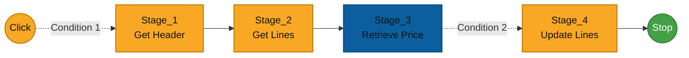

# Algorithm Definition Examples

The following examples show how start points, instructions, variables, and conditions can be used when building algorithms.

---

## Example 1 - Retrieve Price

The algorithm retrieves an item price from the ERP system and stores it in a document line attribute.

### Assumptions

For the `Zamówienia` class, the following are defined:

- header attribute `PH` - Business Partner code,
- line attribute `TOWAR` - item code matching the ERP system,
- line attribute `CENA` - item price,
- line attribute `ILOSC` - quantity.

The following trigger must also be defined on the class lines:

```text
GETPRICE_BT
```

### Diagram



### Process Elements

#### Click

The **Click** start point starts the algorithm after a trigger is used.

#### Condition 1

The transition to `Stage_1` contains the following condition:

```text
EVENTARGS[ITEMCODE] = "GETPRICE_BT"
```

The condition causes the algorithm to execute only for the `GETPRICE_BT` trigger.

#### Stage_1

The instruction retrieves document header data.

- `Instruction type` - **Document Line Operations**,
- `Command type` - `Get Header`,
- `Name` - `Stage_1`,
- `Description` - `Get Header`,
- `Variable` - `HDR`.

Header data is stored in the `HDR` table variable.

#### Stage_2

The instruction retrieves document lines.

- `Instruction type` - **Document Line Operations**,
- `Command type` - `Get Lines`,
- `Name` - `Stage_2`,
- `Description` - `Get Lines`,
- `Variable` - `LINES`.

Line data is stored in the `LINES` table variable.

#### Stage_3

The instruction retrieves the item price from the ERP system.

- `Instruction type` - **Script Operations**,
- `Name` - `Stage_3`,
- `Description` - `Retrieve Price`,
- `Variable` - `SQL`,
- `Script` - example script:

```sql
declare 
    @cc nvarchar(100),
    @qty float,
    @lineid int,
    @item nvarchar(100);

select top 1
    @cc = PH
from #HDR;

select top 1
    @cc = SValue
from dbo.strexplode('<!>', @cc);

select
    @lineid = LINEID
from #EVENTARGS;

select
    @item = TOWAR,
    @qty = isnull(ILOSC, 0)
from #LINES
where SYS_LINEID = @lineid;

if @item is null
begin
    select
        -1 as SYS_LINEID,
        0 as CENA;

    return;
end;

select
    @lineid as SYS_LINEID,
    [$DBNAME].dbo.AFN_GetPrice(@item, @cc, @qty) as CENA;
```

The script uses variables created by previous algorithm stages:

- `#HDR` - header data,
- `#LINES` - line data,
- `#EVENTARGS` - data of the event that started the algorithm.

The result stored in the `SQL` variable contains:

- `SYS_LINEID` - ID of the line to be updated,
- `CENA` - price retrieved from the ERP system.

:::note
The example script applies to integration with SAP Business One.
:::

#### Condition 2

The transition to `Stage_4` contains the following condition:

```text
SQL[SYS_LINEID] >= "0"
```

The condition causes the update to be executed only when the `SQL` variable contains a valid `SYS_LINEID`.

#### Stage_4

The instruction updates the price in the corresponding document line.

- `Instruction type` - **Document Line Operations**,
- `Command type` - `Update Lines`,
- `Name` - `Stage_4`,
- `Description` - `Update Lines`,
- `Variable` - `SQL`.

The `SQL` variable is an input variable created in `Stage_3` and contains:

- `SYS_LINEID` - ID of the line to be updated,
- `CENA` - price value retrieved from the ERP system.

---

#### End Point

The end point closes the algorithm path after `Stage_4` is completed.

## Notes

- Document properties and variables of type `Date` are represented as text in algorithms.