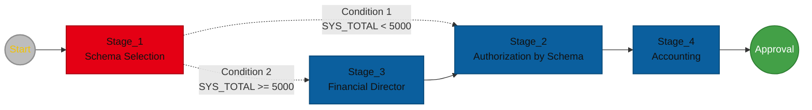

# Authorization Process Examples

The following examples show how authorization stages, parameters, variables, and conditions can be used when building authorization processes.

---

## Example 1 - Decision + Amount

The process routes the document to a user who selects the schema responsible for further authorization. If the document amount is greater than or equal to `5000`, the document additionally passes through a financial director authorization stage. At the end, the document is routed to accounting.

### Assumptions

- The process uses the system field `SYS_TOTAL`, which contains the gross document amount.
- The following authorization schemas are defined:
  - `ZAM_SERWIS`,
  - `ZAM_SERWIS_2`.
- The `DZIAL_FIN` user group is defined.
- The `DEM_KSG` user group is defined.

### Diagram



### Process Elements

#### Start

The start point initializes the authorization process.

#### Stage_1

The first stage is executed by the person who initiated the process (`owner`). During authorization, the user selects the schema that will be used later in the process.

- `Authorization type` - **Authorization with Parameters**.

General properties:

- `Name` - `ETAP_1`,
- `Description` - `Schema selection`,
- `Type` - `Defined User`,
- `Object` - `(owner)`,
- `Variable` - `0`,
- `Auto save` - cleared,
- `Additional information` - `Select the correct schema`.

Parameter:

- `Kind` - `Schema Selection`,
- `Name` - `PSCH`,
- `Description` - `Schema parameter`,
- `Allow null` - cleared,
- `Variable` - `ETAP_1.PSCH`,
- `Type` - `Custom Group`,
- `Values`:
  - `ZAM_SERWIS`,
  - `ZAM_SERWIS_2`.

The selected schema is stored in the `ETAP_1.PSCH` variable.

#### Condition 1

If the value of the `SYS_TOTAL` system field is less than `5000`, the process proceeds to `Stage_2`.

```text
DOC.SYS_TOTAL < "5000"
```

#### Stage_2

This stage performs authorization based on the schema selected in `Stage_1`.

- `Authorization type` - **Basic Authorization**,
- `Name` - `ETAP_2`,
- `Description` - `Authorization by schema`,
- `Type` - `Schema`,
- `Object` - variable `ETAP_1.PSCH`,
- `Variable` - `0`,
- `Auto save` - cleared,
- `Additional information` - `Authorize`.

After the stage is completed, the process proceeds unconditionally to `Stage_4`.

#### Condition 2

If the value of the `SYS_TOTAL` system field is greater than or equal to `5000`, the process proceeds to `Stage_3`.

```text
DOC.SYS_TOTAL >= "5000"
```

#### Stage_3

This stage requires additional authorization by the financial director.

:::note
Instead of assigning a specific user directly in the process, the `DZIAL_FIN` schema based on the `DZIAL_FIN` group is used. The group contains the user who performs the financial director role.

This approach allows the person performing this role to be changed without modifying the process. If the financial director changes, only the membership of the `DZIAL_FIN` group needs to be updated.
:::

- `Authorization type` - **Basic Authorization**,
- `Name` - `ETAP_3`,
- `Description` - `Financial Director`,
- `Type` - `Defined Schema`,
- `Object` - `DZIAL_FIN - One of DZIAL_FIN`,
- `Variable` - `0`,
- `Auto save` - cleared,
- `Additional information` - `The invoice amount is greater than 5000. Please authorize.`

After the stage is completed, the process proceeds unconditionally to `Stage_2`.

#### Stage_4

This stage performs document authorization by accounting.

- `Authorization type` - **Basic Authorization**,
- `Name` - `ETAP_4`,
- `Description` - `Accounting`,
- `Type` - `Defined Schema`,
- `Object` - `DEM_KSG - One of DEM_KSG`,
- `Variable` - `0`,
- `Auto save` - cleared,
- `Additional information` - `Please authorize the document by accounting.`

After the stage is completed, the process proceeds unconditionally to the **Approval** end point.