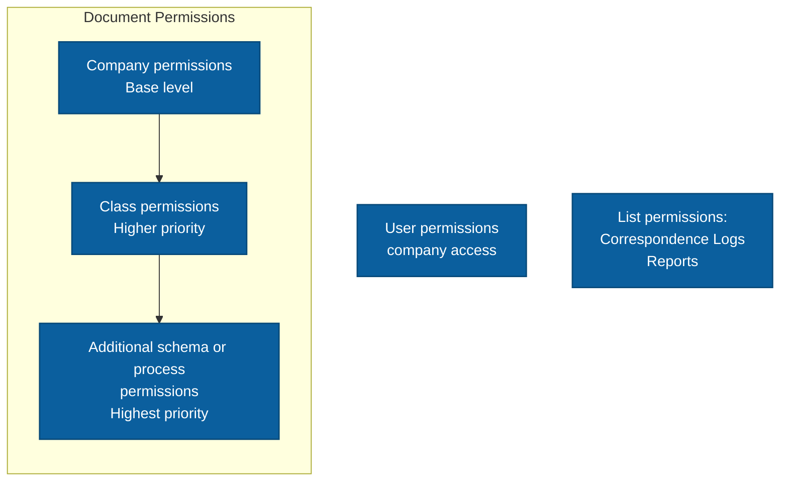

# Permissions

Permissions in SPUMA control access to documents and the ability to perform operations on documents, their attributes, and lines.

## Permission Types

The permission mechanism covers three independent areas:

- **document permissions**,
- **user permissions to companies**,
- **list permissions**.

---

### Document Permissions

Document permissions are checked hierarchically and can be overridden at subsequent levels.

Order:

1. **Company permissions**,
2. **Class permissions**,
3. **Additional authorization schema or process permissions**.

Permissions defined at the class level override the corresponding company permissions.

Permissions defined in an authorization schema or process override the corresponding class and company permissions.

---

### Permission Order

Permissions form a list in which the order of entries matters.

Entries are checked from top to bottom. If several entries apply to the same user or group, an entry located lower in the list can **override** a permission defined earlier.

The order of entries can be changed. To do this, select the required permission and use the arrows available on the list.

:::note
Both the permission level hierarchy:

**Company → Class → Schema / Process**

and the order of entries within a given level are significant.
:::

Example:

1. At the **Company** level, all users are granted full access to documents.
2. At the **Class** level, the **Accounting** group is granted no access.
3. Lower in the class permission list, user **X**, who belongs to the **Accounting** group, is granted view access.
4. The entry for user **X** is checked later and overrides the earlier permissions.

As a result, user **X** has view access to documents of this class, even though full permissions were granted at the **Company** level and no permissions were granted to the **Accounting** group.

---

## Permission Configuration Fields

Permissions are defined using a set of fields that specify the scope and behavior of a given entry.

### Type

The `Type` field specifies the permission type. Available values depend on the configuration location.

- **General**
  - **Description:** Defines basic access to the object and whether it can be viewed or edited.
  - **Available in:** Company, Class, Schema / Process, Correspondence Log.

- **Move**
  - **Description:** Defines whether a document can be moved to another Directory and whether documents that have left the Secretary can be deleted, which moves them to the trash.
  - **Exception:** The document owner can delete a rejected document regardless of this permission.
  - **Available in:** Company, Class, Schema / Process.

- **Edit other users' comments**
  - **Description:** Defines whether an entry can be added to a comment created by another user.
  - **Available in:** Company, Class.

- **Edit field/column**
  - **Description:** Defines whether the specified field or column can be edited.
  - **Available in:** Company, Class, Correspondence Log.

- **Edit other users' lines**
  - **Description:** Defines whether document lines created by other users can be edited.
  - **Available in:** Company, Class, Schema / Process.

- **Change resources**
  - **Description:** Defines whether document pages can be edited.
  - **Available in:** Company, Class, Schema / Process.

- **Create SAP document**
  - **Description:** Defines whether a SAP document can be created based on a document in SPUMA.
  - **Supported statuses:** This permission applies only to documents with the following statuses:
    - **Approved**,
    - **In authorization**.

    Other statuses are not supported for this permission type.
  - **Available in:** Company, Class.

- **Add correspondence log entry**
  - **Description:** Defines whether new entries can be added to the correspondence log.
  - **Available in:** Correspondence Log.

- **Delete correspondence log entry**
  - **Description:** Defines whether entries can be deleted from the correspondence log.
  - **Available in:** Correspondence Log.

- **Edit references**
  - **Description:** Defines whether references associated with a correspondence log entry can be edited.
  - **Available in:** Correspondence Log.

- **Required attribute**
  - **Description:** Defines whether the specified document attribute is required at a given authorization stage.
  - **Available in:** Schema / Process.

### Status

The `Status` field specifies the document status for which the permission applies.

Available values:

- **Approved** - documents that have been approved, and documents that do not require approval and have left the Secretary.
- **Rejected** - document with the `odzrocone` status.
- **In SecretarIAT** - document that is still in the Secretary.
- **In authorization** - document currently undergoing authorization, with the `oczekuje` status.

### Schema

Specifies the authorization schema/process for which the permission entry applies.

This field allows the permission to be limited to documents handled by the selected schema.

### Field

Specifies the field or attribute to which the permission applies.

Depending on the configuration, you can select:

- a specific field,
- all fields.

If the permission does not apply to a single field, the value can refer to the entire document or the entire group of fields.

### Object

The `Object` field specifies the object to which the permission applies.

It can reference:

- a user:
  - a specific user,
  - `(owner)` - document owner,
- a user group:
  - a defined user group,
  - system groups:
    - `(all)` - all users,
    - `(approvers)` - users approving the document,
    - `(auth.omitted)` - users included in the approval process who were skipped because the document was approved by another user,
- for an authorization schema or process - a specific schema or process stage.

### Edit

The `Edit` field specifies the access level granted by the permission.

Depending on the permission type, the field can be displayed as:

- a selection list,
- a checkbox.

For the selection list, the following values are available:

- **Full** - full access to the operation covered by the permission,
- **Preview** - view-only access,
- **None** - no access.

For a checkbox, selecting it grants the permission, while clearing it removes the permission.

---