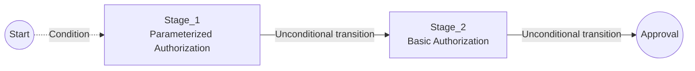

# Process Tab

The **Process** tab is used to define the authorization process diagram. The diagram represents the algorithm describing the stages that a document must pass through to reach the **Approved** status or be **Rejected**.

The process flow may depend on:

- document attribute values,
- decisions made by authorizing users,
- parameters provided during authorization,
- the flow of previous stages.

A process consists of points connected by one-way transitions. Transitions can contain conditions that determine whether the next stage is executed.

Available diagram elements:

- **Start Point**,
- **Basic Authorization**,
- **Parameterized Authorization**,
- **End Points**.

Each process should contain at least:

- one start point,
- one authorization stage,
- one end point.

Two types of end points are available:

- **Final Document Approval** - ends the process and approves the document,
- **Final Document Rejection** - ends the process by rejecting the document.



---

## Basic Authorization

**Basic Authorization** requires the document to be authorized at a given process stage.

### Properties

- `Name` - Authorization stage code.

:::warning
The name must be unique within the process.
:::

- `Description` - Stage description displayed in the administration application and on the diagram.

- `Type` - Specifies how the user or schema responsible for authorization is selected.

| Type | Description |
| --- | --- |
| Defined User | SPUMA user selected directly in the stage configuration. |
| Defined Schema | Authorization schema selected directly in the stage configuration. |
| User | User determined in previous process stages. |
| Custom Schema | Custom schema created in previous process stages. |
| Schema | Schema determined in previous process stages. |

- `Object` - Object used by the selected `Type`. Depending on the type, it can reference a user, authorization schema, or process variable.

- `Variable` - Variable in which the code of the user whose decision completed the authorization stage is stored.

> **Example:** *The stage uses the `Defined Schema` type and the `*DZIAL1` schema, which requires decisions from all users in the department. If users approve the document in the order A, C, B, the code of user B is stored in the variable. If user C rejects the document, the code of user C is stored in the variable.*

- `Auto save` - Automatically saves the document after the authorization stage is approved.

If the option is disabled, after approval the user must additionally:

1. confirm the message about preliminary document approval,
2. save the document using the standard save action.

The authorization is completed only after the document is saved.

If `Auto save` is enabled, the document is saved automatically after approval and does not require additional confirmation or manual saving.

- `Additional information` - Text displayed to the user in the approval window in the web application.

---

## Authorization with Parameters

**Authorization with Parameters** works like **Basic Authorization**, but additionally allows values to be collected from the user while the stage is being executed.

Stage properties outside the `Parameters` tab work the same way as for **Basic Authorization**.

### Parameters

`Parameters` define the values provided by the user while executing the authorization stage.

:::note
An **Authorization with Parameters** stage should contain at least one parameter.
:::

Available parameter types:

| Type | Description |
| --- | --- |
| `Text` | The user enters a text value. |
| `Int` | The user enters an integer. |
| `Float` | The user enters an amount. |
| `User Dictionary` | The user selects a value from a list. |
| `User Selection` | The user selects a user from a list. |
| `Schema` | The user edits a custom schema. |
| `Schema Selection` | The user selects a schema from a list. |

### Parameter Properties

- `Name` - Parameter code.

:::warning
The parameter name must be unique within the process.
:::

- `Description` - Parameter description displayed in the administration application.

- `Allow null` - Specifies whether providing a parameter value is optional.

- `Variable` - Variable in which the value provided by the user is stored. The type of the stored value depends on the parameter type.

Additional properties depend on the parameter type.

#### User Dictionary

For the `User Dictionary` type, the **Values** button is available and opens the local dictionary configuration.

For each dictionary entry, define:

- `Value` - value stored in the parameter,
- `Description` - value description displayed to the user.

#### User Selection

For the `User Selection` type, an additional `Type` property is available.

Available options:

| Type | Description |
| --- | --- |
| All | The user can select any user. |
| Defined Group | The user can select from members of the specified group. |
| Custom Group | The user can select from a manually defined list of users. |

For the `Defined Group` option, an additional property is displayed that allows you to select a group from the group list.

For the `Custom Group` option, the `Values` property is displayed, where a custom list of users is defined.

#### Schema Selection

For the `Schema Selection` type, an additional `Type` property is available.

Available options:

| Type | Description |
| --- | --- |
| All | The user can select any available authorization schema. |
| Custom Group | The user can select from a manually defined list of schemas. |

For the `Custom Group` option, the `Values` property is available, where the list of schemas available for selection is defined.

---

## Conditions

Conditions define whether authorization proceeds from one stage to the next. They are assigned to transitions between authorization process steps.

Transition presentation:

- solid line - transition without a condition,
- dashed line - transition with an assigned condition,
- red line - transition representing a rejection condition.

If the condition assigned to a transition is met, the process proceeds to the next stage. If the condition is not met, the transition is skipped.

A single condition consists of:

```text
left_side operator right_side
```

> **Example:**

```text
DOC._SUMAZ >= "5000"
```

The sides of a condition can contain **Variables**, **Properties**, and **System** values. The right side can additionally contain **Constants** and **Triggers**.

A condition can consist of multiple conditions combined into `AND` or `OR` groups. Groups can be nested.

### Stage Rejection

The transition conditions include a **Rejected** option, which allows you to define a separate process path executed when the document is rejected by a user at a given authorization stage.

If no separate transition is defined for rejection, the document returns to the beginning of the process, to the user who started the process from the **Secretary**.

### Condition Groups

If a transition requires more than one condition to be checked, conditions can be combined into groups:

- `AND` - all conditions or groups within the group must be met,
- `OR` - at least one condition or one group must be met.

> **Example:** *If `kontrola` has the value `Y`, then `kwota` must be greater than `1000` and less than `2000`. If `kontrola` has the value `N`, the entire condition is also met.*

```text
OR Group
├── AND Group
│   ├── HDR[kontrola] = "Y"
│   ├── HDR[kwota] > "1000"
│   └── HDR[kwota] < "2000"
└── HDR[kontrola] = "N"
```

In this example, the `AND` group is met only when all three conditions are true. The parent `OR` group is met when either the `AND` group is met or the `HDR[kontrola] = "N"` condition is true.

### Variables

The **Variables** tab contains:

- the `EVENTARGS` system variable,
- process variables created and populated by individual authorization process stages.

Process variables can store values saved during individual authorization stages, such as parameter values or information about the user whose decision completed the stage. They are available in subsequent process stages and can be used when defining conditions.

A specific variable is referenced by its name:

```text
VARIABLE_NAME
```

> **Example:**

```text
ILOSC > "0"
```

The condition checks the value of the `ILOSC` variable.

#### EVENTARGS

`EVENTARGS` is a system variable available in the **Variables** tab. It contains data related to the event that started the process.

A specific `EVENTARGS` element is referenced by providing its name in square brackets:

```text
EVENTARGS[CLASSID]
```

Available elements:

| Element | Description |
| --- | --- |
| `OBJECTID` | Identifier of the object related to the event. |
| `CLASSID` | Document class identifier. |
| `USERID` | Identifier of the user who triggered the event. |
| `DOCSTATUS` | Document status at the time the event was triggered. |
| `ITEMCODE` | Code of the field related to the event. |
| `ITEMVALUE` | Value of the field related to the event. |
| `LINEID` | Identifier of the document line related to the event. |
| `CLASSATTRIBS_ID` | Identifier of the class attribute related to the event. |

> **Example:**

```text
EVENTARGS[OBJECTID] = 1
```

### Properties

**Properties** allow you to reference document properties.

A document header attribute can be referenced in the following format:

```text
DOC._ATTRIBUTE_NAME
```

> **Example:**

```text
DOC._DATA
```

This references the `DATA` header attribute.

:::warning
The attribute name in the reference should be written in uppercase.
:::

### System

The **System** tab contains system document properties that can be used when defining conditions.

Available properties:

| Property | Type | Description |
| --- | --- | --- |
| `SYS_ID` | `Int` | Document ID. |
| `SYS_USERID` | `Int` | User ID. |
| `SYS_CLASSID` | `Int` | Document class ID. |
| `SYS_COMPANYID` | `Int` | Company ID. |
| `SYS_TEMPLATEID` | `Int` | Template ID. |
| `SYS_NAME` | `Text` | Document name. |
| `SYS_DESCRIPTION` | `Text` | Document description. |
| `SYS_DOCDATE` | `Text` | Document date. |
| `SYS_ENTERDATE` | `Text` | Document receipt date. |
| `SYS_DOCNUM` | `Text` | Document number. |
| `SYS_BUSINESSPARTNER` | `Text` | Document Business Partner. |
| `SYS_DUEDATE` | `Text` | Payment due date. |
| `SYS_BASEID` | `Text` | Base document ID. |
| `SYS_BASEINVOICEID` | `Text` | Base invoice ID. |
| `SYS_TOTAL` | `Float` | Gross document amount. |
| `SYS_NETTOTAL` | `Float` | Net document amount. |
| `SYS_PAYMENTMETHOD` | `Text` | Payment method. |
| `SYS_BASETYPE` | `Text` | Base document type. |
| `SYS_PRICETYPE` | `Text` | Price type. |
| `SYS_CURRENCY` | `Text` | Document currency. |

System properties can be used on both the left and right sides of a condition.

### Constants

**Constants** are available on the right side of a condition and allow a value to be compared with a value entered directly in a text field.

Enter the value without quotation marks. In the saved condition, the constant is displayed in quotation marks.

> **Example:**

```text
DOC._SUMAZ >= "5000"
```

### Triggers

**Triggers** are available on the right side of a condition and allow values related to the event that started the process to be used.

> **Example:**

```text
EVENTARGS[OBJECTID] = "PROPLINE"
```

### Operators

| Operator | Meaning | Type |
| --- | --- | --- |
| `=` | Equal | text, number |
| `!=` | Not equal | text, number |
| `>` | Greater than | number |
| `>=` | Greater than or equal | number |
| `<` | Less than | number |
| `<=` | Less than or equal | number |
| `RX` | Matches regular expression | text |
| `!RX` | Does not match regular expression | text |
| `in` | Value is in the specified set | text, number |
| `not in` | Value is not in the specified set | text, number |

## Clean Up

The **Clean Up** button automatically arranges the tiles in the authorization process diagram.

It can be used after adding or moving elements to automatically arrange them into a readable layout.